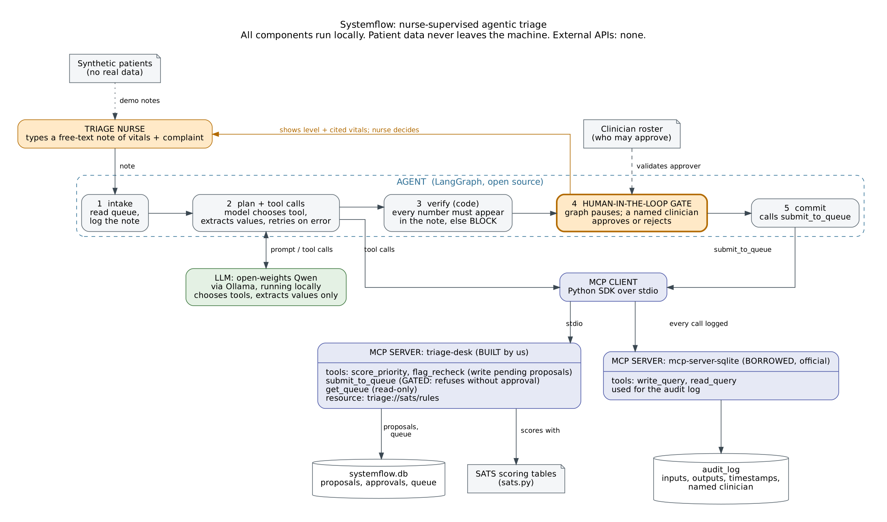

# ARCHITECTURE

## Agent shape

One agent, orchestrated with **LangGraph** (open source), as a five-step graph with a checkpointer
(SQLite) so it can pause for a human and resume:

`intake` -> `plan` -> `verify` -> `human_gate` -> `commit`

- **intake** reads the queue and logs the nurse's note.
- **plan** is the model's job. It reads the free-text note, extracts values, chooses a tool, and
  can read a tool error and retry. New patient: `score_priority`. Waiting patient being re-checked:
  `flag_recheck`. The model is an **open-weights model (Qwen via Ollama)** running locally, because
  patient health data must not leave the country.
- **verify** is code, not a model. Every number the model passed to a tool must appear in the
  nurse's note, and the call must be for the right patient. Otherwise the proposal is blocked and no
  nurse is asked to approve something built on an invented value.
- **human_gate** is a LangGraph `interrupt`. The graph stops until a named clinician on the roster
  approves or rejects. Approval is recorded by this step in code. It is not an MCP tool, so no model
  can approve its own work.
- **commit** calls `submit_to_queue`, which independently re-checks that an approval exists.

The model decides *which tool and with what arguments*. It never computes a priority: scoring is
deterministic code in `sats.py`, which makes every level reproducible and citable.

## MCP servers: built versus borrowed

| Server | Built or borrowed | Why |
|---|---|---|
| `triage-desk` (ours) | Built | The domain logic must be ours. Tools: `score_priority`, `flag_recheck` (both write pending proposals), `submit_to_queue` (acts on the queue, gated), `get_queue` (read-only). Resource: `triage://sats/rules` |
| `mcp-server-sqlite` (official) | Borrowed | Storing an audit log is not our differentiator; the maintained server does it, and it keeps the log in a separate, standard tool |

The agent is an MCP client over stdio to both. The model is offered only `score_priority`,
`flag_recheck` and `get_queue`.

## Data flow

Nurse note -> agent (model extracts values) -> `score_priority` / `flag_recheck` on `triage-desk`
(pending proposal) -> `verify` -> **nurse approves or rejects** -> `submit_to_queue` (refuses without
approval) -> queue. Each step writes to `audit_log` through the borrowed SQLite server. Data stays in
local SQLite files; there are no external cloud APIs.

## Stack

Python, LangGraph, official MCP Python SDK (FastMCP), `mcp-server-sqlite`, Ollama with Qwen
(open-weights), SQLite. Patients are synthetic.

## Limits

Keyword discriminators ignore negation (EVALS.md, E16). SATS tables need verification against the
official manual. The discriminator list is a subset. No real clinical validation has been done.
